NexoFin AI

Documento de diseño del sistema

Arquitectura · Casos de uso · Clases · Secuencia · DER · Modelo relacional · Interfaces

Programación III

Instituto Tecnológico de las Américas (ITLA)

Profesora: Eduandy Isabel Cruz Abreu

Octubre de 2026

Integrantes

Paola Piantini · 2025-1222

Brailin Mendez · 2024-1281

Romel Augusto Rojas · 2025-1022

Luiggi Medrano Ramírez · 2022-1095

Stack: Flutter (cliente) · API REST · PostgreSQL

# Contenido

1. Arquitectura propuesta

2. Diagrama de casos de uso

3. Diagrama de clases UML

4. Diagramas de secuencia

5. Modelo entidad-relación (DER)

6. Modelo relacional

7. Prototipo de interfaces (wireframes)

Anexo A. Trazabilidad con el SRS

Alcance de este documento. Se diseña el nivel 1 (núcleo comprometido) del SRS v2.0 y, donde el modelo de datos lo exige, los niveles 2 y 3, para que ampliar el sistema no obligue a rediseñar la base de datos. Los identificadores RF, RNF, RN y CU son los del SRS.

# 1. Arquitectura propuesta

## 1.1 Decisión

Se propone un monolito modular en capas: una sola aplicación backend (API REST sin estado) organizada en módulos por dominio (AUT, CTA, TRX, IMP, CAT, PRE, SIM, ASI, NOT, DAS, AUD) y en capas de responsabilidad, consumida por un cliente Flutter y respaldada por PostgreSQL.

Por qué esta opción y no otra:

| Alternativa | Ventajas | Desventajas para este proyecto | Decisión |
| --- | --- | --- | --- |
| Monolito modular en capas | Un solo despliegue, transacciones SQL atómicas simples (RNF-CON-02), fácil de probar y de correr en un equipo local (RNF-MNT-05), curva de aprendizaje baja | Hay que cuidar la disciplina de límites entre módulos | ELEGIDA |
| Microservicios | Escalado independiente por servicio | Con 4 personas, 12 semanas y costo RD$0 el costo operativo es excesivo; las operaciones atómicas (transferencia, pago de deuda, importación) se vuelven transacciones distribuidas | Descartada |
| Serverless / BaaS (Firebase, Supabase) | Poco backend que escribir | El motor financiero determinístico y las reglas de negocio no encajan bien en funciones aisladas; dependencia de límites de capas gratuitas (riesgo R5) | Descartada |
| Lógica en el cliente + BD directa | Menos código servidor | Viola RNF-SEG-05 (autorización siempre en el servidor) y RNF-MNT-01 | Descartada |

La separación en capas cumple RNF-MNT-01 y RNF-REN-04: el motor financiero vive en la capa de dominio, no depende de la base de datos ni de la IA, y puede probarse de forma aislada. Si más adelante el procesamiento de archivos o la IA necesitan escalar, esos módulos ya están detrás de interfaces (adaptadores) y pueden extraerse a un servicio sin tocar el modelo de datos.

## 1.2 Vista general

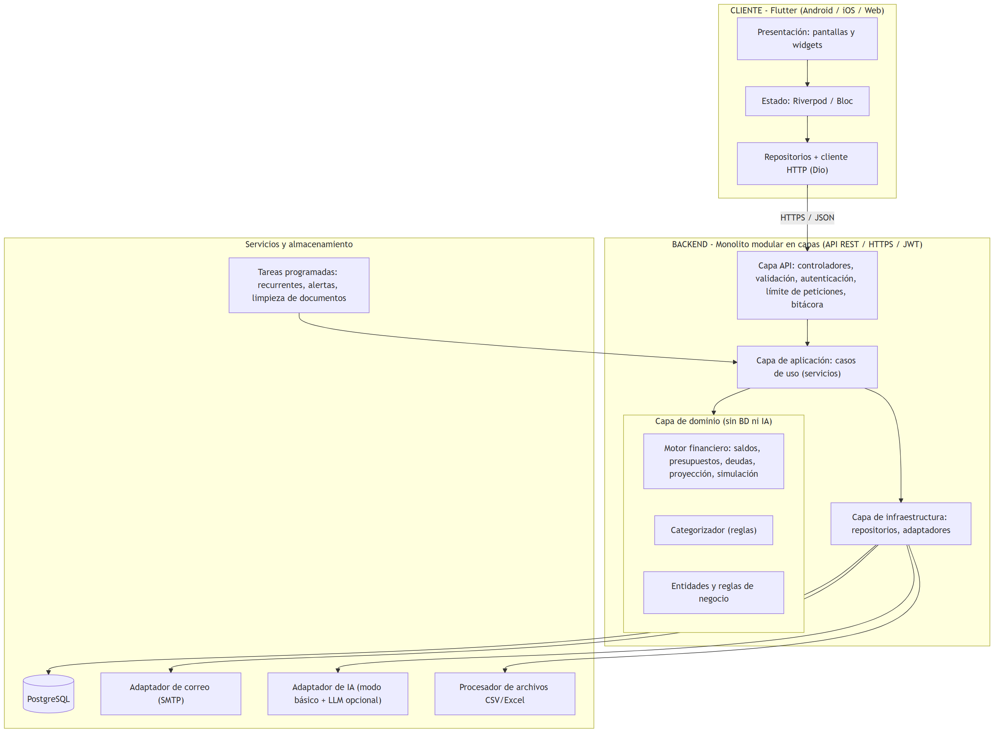

Figura 1. Arquitectura del sistema (monolito modular en capas).

## 1.3 Tecnologías

| Componente | Tecnología | Justificación |
| --- | --- | --- |
| Cliente | Flutter 3 (Dart), Material 3 | Un solo código para móvil y web adaptable (RNF-USA-03); el SRS deja fuera la app nativa, Flutter Web cubre el requisito web |
| Estado del cliente | Riverpod (o Bloc) + Dio para HTTP | Separa UI, estado y repositorios; facilita pruebas |
| Backend | Node.js + TypeScript (Express), validación con Zod | Gratuito, equipo con experiencia previa en Express. Es reemplazable: el diseño no depende del lenguaje |
| Base de datos | PostgreSQL 16 | NUMERIC exacto (RNF-DAT-02), transacciones ACID, JSONB para snapshots de simulaciones, vistas para saldos |
| Autenticación | JWT de corta duración + sesión revocable en BD; hash con Argon2id o bcrypt | RNF-SEG-02, SEG-04 |
| IA del asistente | Modo básico (reglas + plantillas) siempre disponible; LLM local o gratuito opcional detrás de una interfaz | RNF-IA-07, IA-09, MNT-05 |
| Procesamiento de archivos | Lectores de CSV y Excel (N2) | RF-IMP |
| Despliegue de la demo | Docker Compose (API + PostgreSQL) en equipo local; Flutter Web servido estático | Costo RD$0 (RNF-MNT-05); HTTPS requerido fuera de localhost (RNF-SEG-01) |

## 1.4 Responsabilidad de cada capa

| Capa | Responsabilidad | No debe |
| --- | --- | --- |
| Presentación (Flutter) | Pantallas, validación de formularios, estados de carga y error, formato RD$ y DD/MM/AAAA | Contener reglas de negocio ni decidir autorización |
| API (controladores) | Rutas REST, validación de entrada, autenticación JWT, límite de peticiones, ID de correlación, mapeo de errores | Acceder directo a la BD ni calcular montos |
| Aplicación (servicios) | Orquesta casos de uso (CU-*), define la transacción atómica, llama a dominio e infraestructura, registra la bitácora | Contener fórmulas financieras |
| Dominio | Entidades y reglas del Anexo B: saldos, presupuestos, cuotas, saldo libre proyectado, simulación, categorización | Depender de BD, red, framework o IA |
| Infraestructura | Repositorios PostgreSQL, adaptadores de correo, IA y archivos, tareas programadas | Contener reglas de negocio |

## 1.5 Decisiones transversales

- Seguridad: HTTPS; contraseñas con hash y sal; toda consulta filtra por usuario_id obtenido del token (nunca del cuerpo de la petición) para cumplir RNF-SEG-05; límite de peticiones en login, recuperación, importación y asistente; secretos solo en variables de entorno (RNF-SEG-07).
- Integridad financiera: importes en NUMERIC(14,2) con redondeo único al final de cada cálculo (RN-DAT-01); transferencias, pagos de deuda y confirmación de importaciones dentro de una transacción SQL (RNF-CON-02); el saldo se deriva con una vista y no se almacena (RNF-CON-05).
- Bajas lógicas: nada financiero se borra físicamente; las ediciones guardan el valor anterior (RN-DAT-04).
- IA acotada: el LLM solo interpreta la pregunta y redacta; todas las cifras salen del motor financiero y se validan antes de mostrarse (RNF-IA-01). Si la IA falla, el resto del sistema sigue funcionando (RNF-IA-07).
- Tareas automáticas: las recurrentes se generan al iniciar sesión o consultar (RN-TRX-04), sin depender de un cron en el servidor gratuito (riesgo R5).
- Configuración y observabilidad: parámetros (umbrales, límites, tiempos) en variables de entorno; registros con ID de correlación sin datos sensibles (RNF-MNT-03, MNT-04).

## 1.6 Estructura de carpetas sugerida

backend/
  src/
    api/            # controladores, middlewares (auth, rate-limit, errores)
    application/    # servicios por caso de uso
    domain/         # motor financiero, entidades, categorizador (sin dependencias)
    infrastructure/ # repositorios SQL, adaptadores correo/IA/archivos
    config/
  tests/
  db/schema.sql
app/ (Flutter)
  lib/
    core/           # tema, formato RD$, cliente HTTP
    features/       # auth, cuentas, transacciones, presupuestos, simulacion, asistente...
      <feature>/ {data, domain, presentation}

# 2. Diagrama de casos de uso

## 2.1 Actores

| Actor | Tipo | Descripción |
| --- | --- | --- |
| Usuario (Visitante) | Humano, principal | Sin sesión: se registra, inicia sesión o recupera su contraseña |
| Usuario (Verificado) | Humano, principal | Con sesión activa: usa todas las funciones financieras |
| Servicio de correo | Sistema externo | Envía verificación, recuperación y notificaciones |
| Proveedor de IA | Sistema externo | Interpreta preguntas y redacta explicaciones; no calcula cifras |
| Temporizador / Sistema | Sistema interno | Genera recurrentes, notificaciones y alertas |

Por legibilidad el diagrama se divide en tres vistas. Las líneas punteadas son relaciones «include» (paso obligatorio) o «extend» (comportamiento opcional), y apuntan de acuerdo con la convención UML.

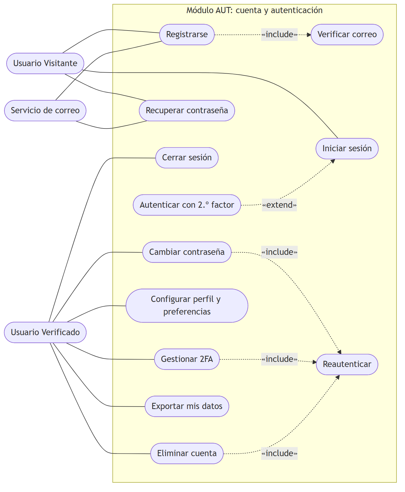

Figura 2. Casos de uso: cuenta de usuario y autenticación (AUT).

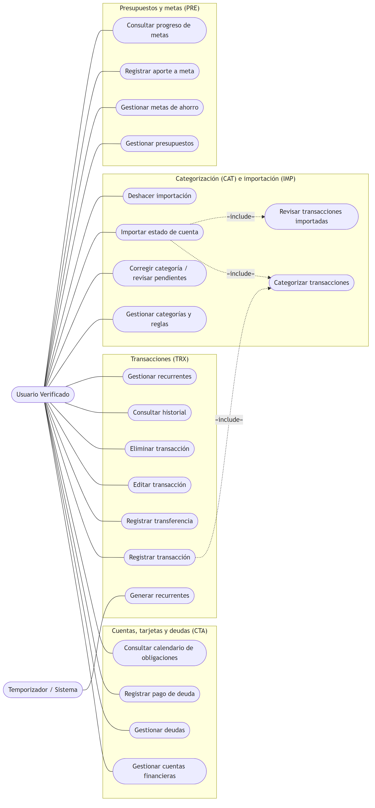

Figura 3. Casos de uso: cuentas, transacciones, categorización, importación, presupuestos y metas.

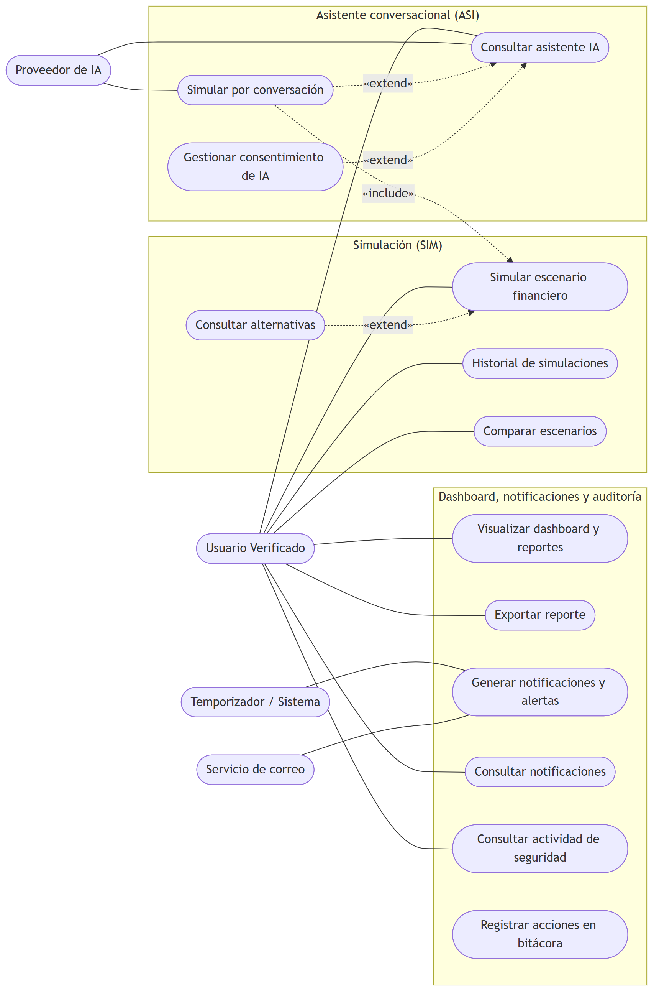

Figura 4. Casos de uso: simulación, asistente, dashboard, notificaciones y auditoría.

## 2.2 Catálogo de casos de uso

| ID | Caso de uso | Actores | Nivel |
| --- | --- | --- | --- |
| CU-AUT-01 | Registrarse | Visitante; Correo | N1 |
| CU-AUT-02 | Verificar correo electrónico | Visitante; Correo | N3 |
| CU-AUT-03 | Iniciar sesión | Visitante | N1 |
| CU-AUT-04 | Autenticar con segundo factor | Visitante | N3 |
| CU-AUT-05 | Recuperar contraseña | Visitante; Correo | N1 |
| CU-AUT-06 | Cerrar sesión | Verificado | N1 |
| CU-AUT-07 | Reautenticar usuario | Verificado | N3 |
| CU-AUT-08 | Cambiar contraseña | Verificado | N3 |
| CU-AUT-09 | Gestionar autenticación en dos pasos | Verificado | N3 |
| CU-AUT-10 | Configurar perfil y preferencias | Verificado | N1 |
| CU-AUT-11 | Eliminar cuenta | Verificado | N3 |
| CU-AUT-12 | Exportar mis datos | Verificado | N3 |
| CU-CTA-01 | Gestionar cuentas financieras | Verificado | N1 |
| CU-CTA-02 | Gestionar deudas | Verificado | N1 |
| CU-CTA-03 | Registrar pago de deuda | Verificado | N1 |
| CU-CTA-04 | Consultar calendario de obligaciones | Verificado | N3 |
| CU-TRX-01 | Registrar transacción | Verificado | N1 |
| CU-TRX-02 | Registrar transferencia entre cuentas | Verificado | N1 |
| CU-TRX-03 | Editar transacción | Verificado | N1 |
| CU-TRX-04 | Eliminar transacción | Verificado | N1 |
| CU-TRX-05 | Consultar historial de transacciones | Verificado | N1 |
| CU-TRX-06 | Gestionar transacciones recurrentes | Verificado | N1 |
| CU-TRX-07 | Generar transacciones recurrentes | Temporizador | N1 |
| CU-IMP-01 | Importar estado de cuenta | Verificado | N2 |
| CU-IMP-02 | Revisar transacciones importadas | Verificado | N2 |
| CU-IMP-03 | Deshacer importación | Verificado | N3 |
| CU-CAT-01 | Categorizar transacciones | Sistema | N1 |
| CU-CAT-02 | Gestionar categorías y reglas | Verificado | N1 |
| CU-CAT-03 | Corregir categoría y revisar pendientes | Verificado | N1 |
| CU-PRE-01 | Gestionar presupuestos | Verificado | N1 |
| CU-PRE-02 | Gestionar metas de ahorro | Verificado | N1 |
| CU-PRE-03 | Registrar aporte a meta | Verificado | N1 |
| CU-PRE-04 | Consultar progreso de metas | Verificado | N1 |
| CU-SIM-01 | Simular escenario financiero | Verificado | N1 |
| CU-SIM-02 | Consultar alternativas | Verificado | N2 |
| CU-SIM-03 | Consultar historial de simulaciones | Verificado | N2 |
| CU-SIM-04 | Comparar escenarios | Verificado | N3 |
| CU-ASI-01 | Consultar asistente IA | Verificado; Proveedor de IA | N1 |
| CU-ASI-02 | Simular por conversación | Verificado; Proveedor de IA | N1 |
| CU-ASI-03 | Gestionar consentimiento de IA | Verificado | N1 |
| CU-NOT-01 | Generar notificaciones y alertas | Temporizador; Correo | N2 |
| CU-NOT-02 | Consultar notificaciones | Verificado | N3 |
| CU-DAS-01 | Visualizar dashboard y reportes | Verificado | N1 |
| CU-DAS-02 | Exportar reporte | Verificado | N3 |
| CU-AUD-01 | Consultar actividad de seguridad | Verificado | N3 |
| CU-AUD-02 | Registrar acciones en la bitácora | Sistema | N1 |

## 2.3 Especificación de casos de uso críticos

### CU-TRX-01 · Registrar transacción

| Campo | Detalle |
| --- | --- |
| Actor | Usuario (Verificado) |
| Precondición | Sesión activa y al menos una cuenta activa. |
| Postcondición | Transacción guardada; saldo y presupuesto consumido actualizados; categoría asignada o pendiente de revisión. |

Flujo principal

1. El usuario elige registrar una transacción y su tipo (ingreso, gasto o ajuste; la transferencia es CU-TRX-02).

2. Ingresa monto, fecha, cuenta, categoría (opcional) y nota.

3. El sistema valida monto > 0, fecha válida (no futura) y campos obligatorios.

4. Si no hay categoría, se ejecuta CU-CAT-01.

5. El sistema guarda la transacción y recalcula el saldo en una sola operación atómica.

6. Actualiza el presupuesto consumido; si supera el umbral, dispara CU-NOT-01.

7. Confirma el registro.

Flujos alternativos

- Datos inválidos: no se guarda y se señala cada campo.
- Cuenta archivada: no admite movimientos.
- Confianza baja: queda pendiente de revisión, sin categoría por suposición.
- Fallo al guardar: no queda registro parcial ni saldo alterado.

### CU-CTA-03 · Registrar pago de deuda

| Campo | Detalle |
| --- | --- |
| Actor | Usuario (Verificado) |
| Precondición | Sesión activa, deuda con saldo pendiente > 0 y cuenta de origen activa. |
| Postcondición | Gasto asociado registrado; saldo de la cuenta y de la deuda recalculados. |

Flujo principal

1. El usuario elige una deuda y registrar un pago.

2. Ingresa monto, fecha y cuenta de origen.

3. El sistema valida los datos.

4. En una sola operación atómica crea el gasto, descuenta la cuenta y aplica el pago a las cuotas (la más antigua primero).

5. Muestra el saldo pendiente y la fecha de la próxima cuota.

Flujos alternativos

- Monto mayor al saldo pendiente: se rechaza e indica el saldo.
- Cuenta archivada: no puede seleccionarse.
- Fallo durante la operación: no queda ningún cambio parcial.

### CU-SIM-01 · Simular escenario financiero

| Campo | Detalle |
| --- | --- |
| Actor | Usuario (Verificado) |
| Precondición | Sesión activa; datos suficientes (ingresos esperados y al menos un mes de historial). |
| Postcondición | Resultado con supuestos visibles; simulación asociada a la versión de los datos usados y guardable en el historial. |

Flujo principal

1. El usuario elige el tipo: gasto único, ahorro para una meta o compra a cuotas.

2. Ingresa los parámetros.

3. El sistema valida.

4. El motor financiero calcula el escenario base y el simulado con datos persistidos.

5. Muestra el saldo libre proyectado antes y después y el efecto en presupuestos, metas y obligaciones.

6. Muestra los supuestos usados.

7. Si el saldo queda negativo o se excede un presupuesto, ofrece CU-SIM-02 (alternativas).

8. El usuario puede guardar la simulación.

Flujos alternativos

- Datos insuficientes: explica qué falta y no muestra ninguna cifra como exacta (RN-SIM-08).
- Parámetros inválidos: señala qué corregir.

### CU-ASI-01 · Consultar asistente IA

| Campo | Detalle |
| --- | --- |
| Actor | Usuario (Verificado); Proveedor de IA |
| Precondición | Sesión activa y consentimiento vigente si se usa IA externa. |
| Postcondición | Respuesta etiquetada (cálculo, estimación o educativo) con cifras trazables; conversación guardada. |

Flujo principal

1. El usuario escribe una pregunta.

2. El sistema verifica consentimiento y límite diario (50 consultas).

3. Se interpreta la intención y los parámetros (reglas o LLM, sin datos personales).

4. Si es descriptiva, el motor ejecuta la consulta; si es hipotética, se ejecuta CU-ASI-02.

5. Si falta un dato, el asistente lo solicita.

6. Se redacta la explicación a partir del resultado del motor.

7. El sistema verifica que toda cifra tenga origen.

8. Muestra la respuesta con etiqueta, aviso y acceso al detalle; guarda la conversación.

Flujos alternativos

- Sin consentimiento: CU-ASI-03; no se envían datos.
- Consulta ajena a las finanzas: se rechaza con mensaje.
- Datos insuficientes: se declara.
- IA no disponible: aviso, y el resto de la app sigue funcionando.
- Cifra sin origen: se bloquea o corrige.
- Texto con instrucciones incrustadas: se trata como dato.

# 3. Diagrama de clases UML

El modelo de clases se presenta en tres vistas: (a) entidades del dominio, (b) servicios, motor financiero y asistente, y (c) importación y conversación. Los tipos Decimal se implementan como NUMERIC en la base de datos y como un tipo decimal exacto (no coma flotante) en el código.

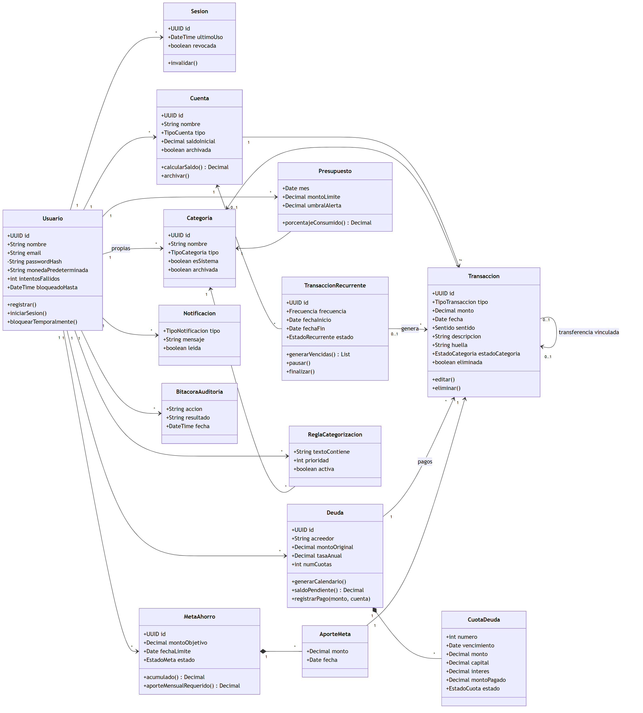

Figura 5. Diagrama de clases: entidades del dominio.

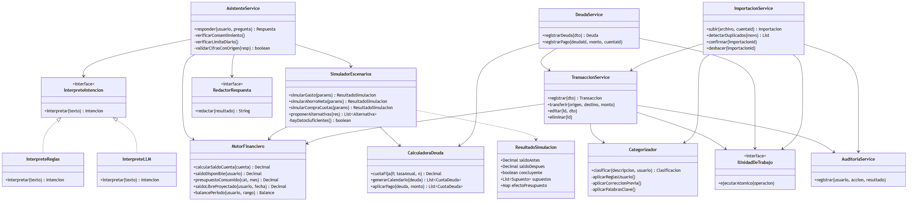

Figura 6. Diagrama de clases: servicios, motor financiero y asistente.

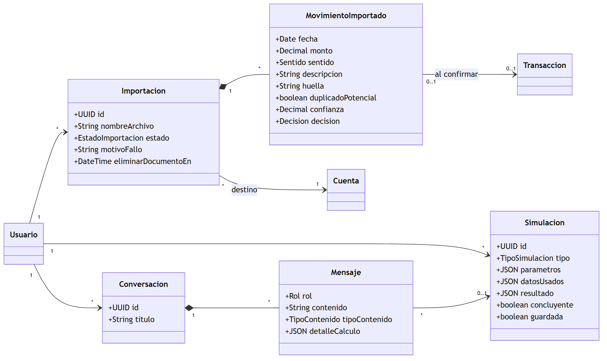

Figura 7. Diagrama de clases: importación, simulación y conversación.

### Notas de diseño

- MotorFinanciero y CalculadoraDeuda son puros (sin BD ni IA): reciben datos y devuelven resultados, por lo que se prueban con casos conocidos (RNF-MNT-02).
- InterpreteIntencion es una interfaz con dos implementaciones: InterpreteReglas (modo básico, siempre disponible) e InterpreteLLM (opcional). Esto cumple RNF-IA-09 y RNF-MNT-01.
- IUnidadDeTrabajo representa la transacción de base de datos; los servicios que mueven dinero (transferir, pagar deuda, confirmar importación) la usan para garantizar atomicidad.
- Transaccion usa un tipo y un sentido (entrada/salida) en lugar de subclases: simplifica el cálculo de saldo (RN-CTA-01) y el mapeo a tabla. Una transferencia son dos transacciones vinculadas.

# 4. Diagramas de secuencia

Se modelan cinco procesos clave del SRS: inicio de sesión, registro de transacción, pago de deuda, simulación mediante el asistente e importación de estado de cuenta.

Cubre el bloqueo tras 5 intentos fallidos, el error genérico y la bitácora de auditoría.

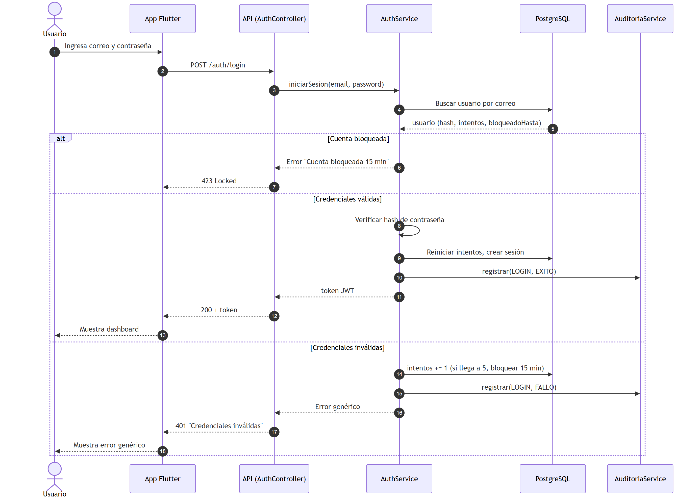

Figura 8. Secuencia: iniciar sesión (CU-AUT-03).

Muestra la categorización automática, la transacción atómica y la alerta de presupuesto.

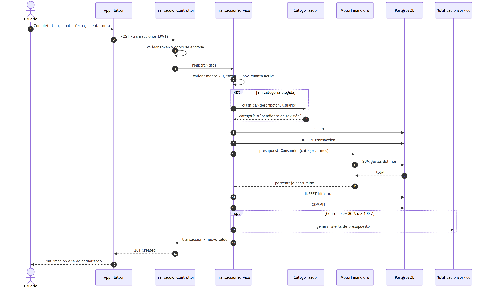

Figura 9. Secuencia: registrar transacción (CU-TRX-01).

Muestra la validación y la operación atómica que crea el gasto y actualiza las cuotas.

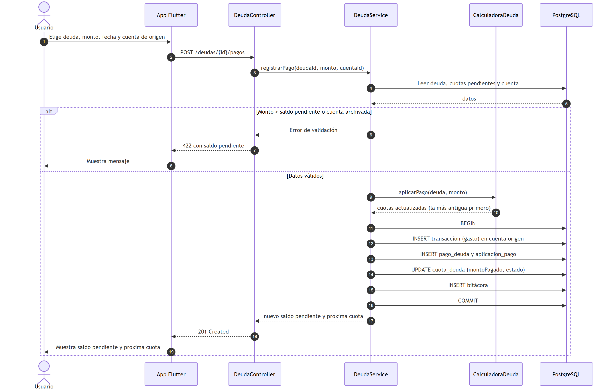

Figura 10. Secuencia: registrar pago de deuda (CU-CTA-03).

Muestra la verificación de consentimiento, la interpretación, la solicitud de datos faltantes y la validación de cifras.

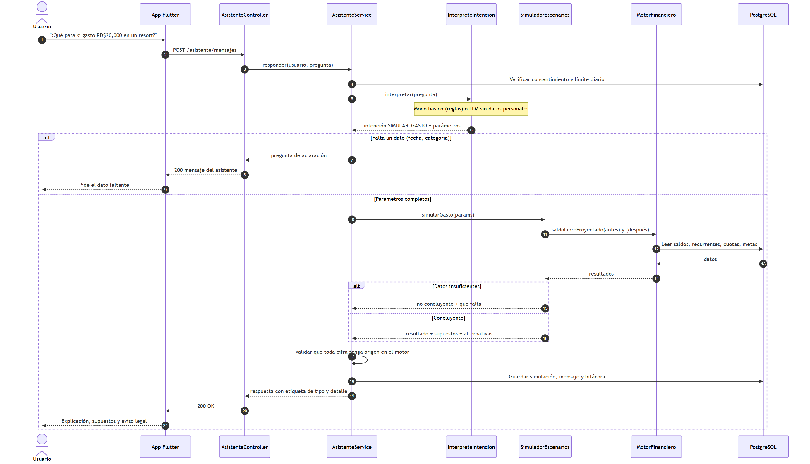

Figura 11. Secuencia: simulación mediante el asistente (CU-ASI-01 y CU-ASI-02).

Muestra el procesamiento en segundo plano, la detección de duplicados y la confirmación atómica.

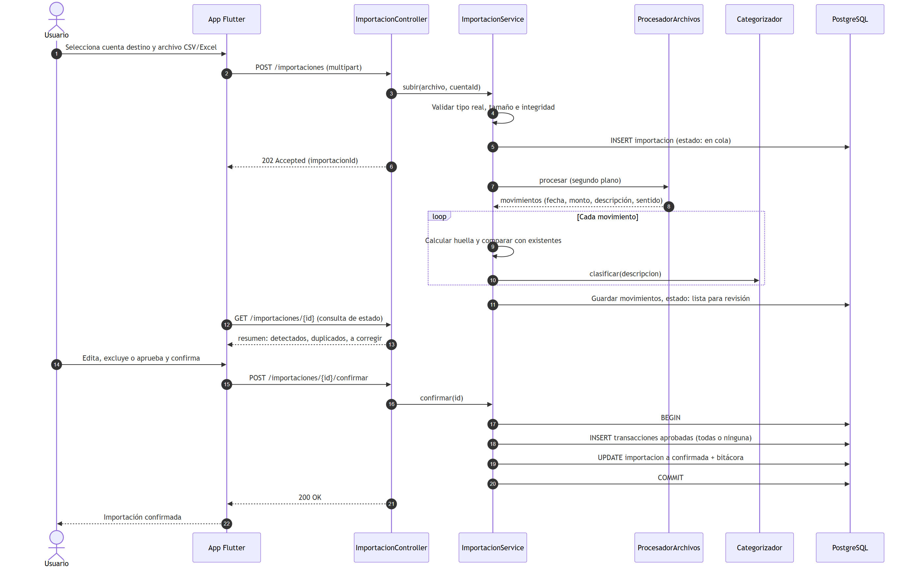

Figura 12. Secuencia: importar estado de cuenta (CU-IMP-01 y CU-IMP-02, nivel 2).

# 5. Modelo entidad-relación (DER)

El DER se divide en tres vistas por módulo para que sea legible. Notación pata de gallo: || uno obligatorio, |o uno opcional, o{ cero o muchos. Las entidades repetidas en varias vistas (USUARIO, CUENTA, TRANSACCION) se muestran solo con su clave.

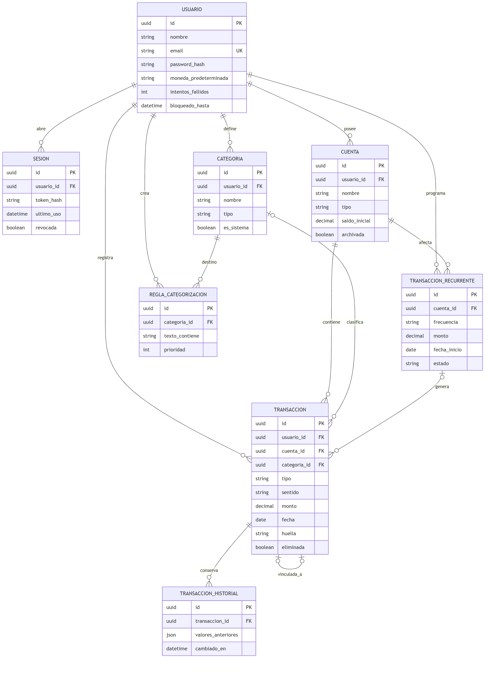

Figura 13. DER: usuarios, cuentas, categorías y transacciones.

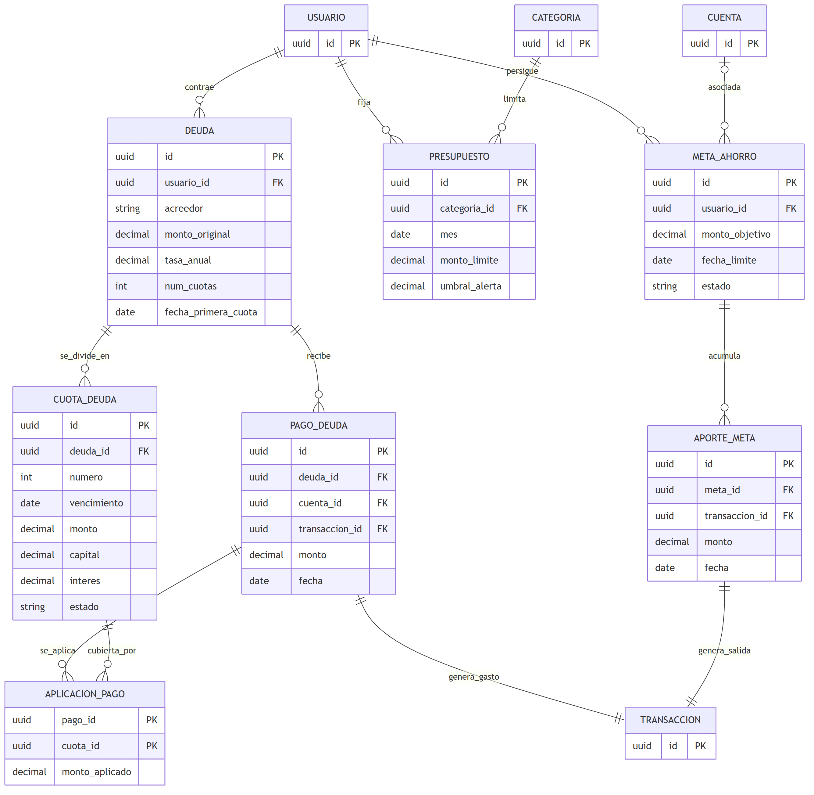

Figura 14. DER: deudas, presupuestos y metas de ahorro.

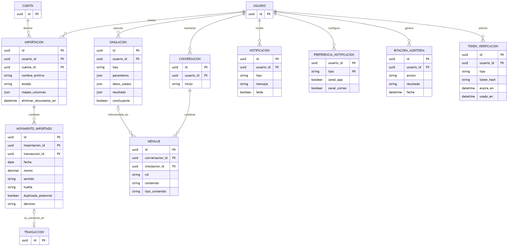

Figura 15. DER: importación, simulación, asistente, notificaciones y auditoría.

### Decisiones de modelado

- Transferencia = dos filas de TRANSACCION (una salida y una entrada) enlazadas por transferencia_vinculada_id; así el saldo de cada cuenta sale de una suma simple.
- Pago de deuda y aporte a meta generan una TRANSACCION (gasto y aporte_meta respectivamente), y se vinculan 1 a 1. El aporte no cuenta como gasto en presupuestos (RN-MET-03).
- APLICACION_PAGO resuelve la relación N:M entre pagos y cuotas: un pago puede cubrir varias cuotas y una cuota puede pagarse en varios pagos (RN-DEU-03).
- CATEGORIA.usuario_id nulo identifica las categorías del sistema, compartidas por todos los usuarios y no eliminables.
- Saldos nunca almacenados: se derivan con vistas (saldo de cuenta, saldo pendiente de deuda), evitando inconsistencias (RNF-CON-05).
- SIMULACION guarda un snapshot (datos_usados) para reproducir el mismo resultado (RN-SIM-09).

# 6. Modelo relacional

Esquema para PostgreSQL 16 con 24 tablas y 2 vistas. Todas las claves primarias son UUID, salvo la bitácora (identidad numérica). Los importes usan NUMERIC(14,2). Los dominios cerrados se validan con CHECK. El script ejecutable completo está en el archivo esquema.sql que acompaña este documento.

## 6.1 Resumen de tablas

| Tabla | Propósito |
| --- | --- |
| usuario | Persona registrada en el sistema (RF-AUT). |
| sesion | Sesión/token activo del usuario (RF-AUT-03, 04). |
| token_verificacion | Enlaces de un solo uso: verificar correo / restablecer contraseña. |
| cuenta | Cuenta de efectivo, bancaria o tarjeta de crédito (RF-CTA). |
| categoria | Categoría de ingreso o gasto; las del sistema tienen usuario_id NULL (RF-CAT-05). |
| transaccion_recurrente | Plantilla de ingreso/gasto que se repite (RF-TRX-06). |
| importacion | Carga de un estado de cuenta CSV/Excel (RF-IMP). |
| transaccion | Movimiento financiero: ingreso, gasto, transferencia, ajuste o aporte a meta (RF-TRX). |
| transaccion_historial | Valores anteriores de cada edición (RF-TRX-03). |
| movimiento_importado | Movimiento detectado en un archivo, pendiente de aprobar (RF-IMP-06). |
| regla_categorizacion | Regla del usuario: si la descripción contiene X, asignar categoría Y (RF-CAT-02). |
| deuda | Obligación con calendario de cuotas (RF-CTA-06). |
| cuota_deuda | Cuota del calendario (sistema francés, RN-DEU-01/02). |
| pago_deuda | Pago realizado a una deuda (RF-CTA-07). |
| aplicacion_pago | Reparte un pago entre cuotas, la más antigua primero (RN-DEU-03). |
| presupuesto | Límite mensual por categoría (RF-PRE-01). |
| meta_ahorro | Objetivo de ahorro con monto y fecha (RF-PRE-03). |
| aporte_meta | Aporte a una meta; el acumulado es la suma de aportes (RN-MET-01). |
| simulacion | Resultado de una simulación con copia de los datos usados (RN-SIM-09). |
| conversacion | Hilo de conversación con el asistente (RF-ASI-08). |
| mensaje | Mensaje del usuario o del asistente. |
| notificacion | Aviso dentro de la app (RF-NOT). |
| preferencia_notificacion | Canales elegidos por tipo de notificación (RF-NOT-02). |
| bitacora_auditoria | Registro inmutable de acciones sensibles (RF-AUD-01). |

## 6.2 Detalle de tablas

### usuario

Persona registrada en el sistema (RF-AUT).

| Atributo | Tipo y restricciones | Observación |
| --- | --- | --- |
| id | UUID PRIMARY KEY DEFAULT gen_random_uuid() |  |
| nombre | VARCHAR(100) NOT NULL |  |
| email | VARCHAR(255) NOT NULL UNIQUE | Único; se guarda en minúsculas |
| password_hash | VARCHAR(255) NOT NULL | Argon2id/bcrypt con sal (RNF-SEG-02) |
| moneda_predeterminada | CHAR(3) NOT NULL DEFAULT 'DOP' | RD$ en N1 |
| zona_horaria | VARCHAR(40) NOT NULL DEFAULT 'America/Santo_Domingo' | RN-DAT-03 |
| foto_url | VARCHAR(500) |  |
| email_verificado | BOOLEAN NOT NULL DEFAULT FALSE | N3 |
| dos_factores_activo | BOOLEAN NOT NULL DEFAULT FALSE | N3 |
| intentos_fallidos | SMALLINT NOT NULL DEFAULT 0 | RN-SEG-02 |
| bloqueado_hasta | TIMESTAMPTZ | Bloqueo de 15 min |
| consentimiento_ia_en | TIMESTAMPTZ | NULL = sin consentimiento (RNF-PRI-03) |
| creado_en | TIMESTAMPTZ NOT NULL DEFAULT now() |  |

### sesion

Sesión/token activo del usuario (RF-AUT-03, 04).

| Atributo | Tipo y restricciones | Observación |
| --- | --- | --- |
| id | UUID PRIMARY KEY DEFAULT gen_random_uuid() |  |
| usuario_id | UUID NOT NULL REFERENCES usuario(id) ON DELETE CASCADE |  |
| token_hash | VARCHAR(255) NOT NULL UNIQUE | Se guarda el hash, nunca el token |
| creada_en | TIMESTAMPTZ NOT NULL DEFAULT now() |  |
| ultimo_uso | TIMESTAMPTZ NOT NULL DEFAULT now() | Expira a los 30 min de inactividad |
| revocada | BOOLEAN NOT NULL DEFAULT FALSE |  |

### token_verificacion

Enlaces de un solo uso: verificar correo / restablecer contraseña.

| Atributo | Tipo y restricciones | Observación |
| --- | --- | --- |
| id | UUID PRIMARY KEY DEFAULT gen_random_uuid() |  |
| usuario_id | UUID NOT NULL REFERENCES usuario(id) ON DELETE CASCADE |  |
| tipo | VARCHAR(20) NOT NULL CHECK (tipo IN ('verificacion','reset')) |  |
| token_hash | VARCHAR(255) NOT NULL UNIQUE |  |
| expira_en | TIMESTAMPTZ NOT NULL | 24 h verificación; 30 min reset |
| usado_en | TIMESTAMPTZ |  |

### cuenta

Cuenta de efectivo, bancaria o tarjeta de crédito (RF-CTA).

| Atributo | Tipo y restricciones | Observación |
| --- | --- | --- |
| id | UUID PRIMARY KEY DEFAULT gen_random_uuid() |  |
| usuario_id | UUID NOT NULL REFERENCES usuario(id) ON DELETE CASCADE |  |
| nombre | VARCHAR(80) NOT NULL |  |
| tipo | VARCHAR(15) NOT NULL CHECK (tipo IN ('efectivo','bancaria','tarjeta')) |  |
| moneda | CHAR(3) NOT NULL DEFAULT 'DOP' |  |
| saldo_inicial | NUMERIC(14,2) NOT NULL DEFAULT 0 | RNF-DAT-02: decimal exacto |
| limite_credito | NUMERIC(14,2) | Solo tarjetas (N3) |
| dia_corte | SMALLINT CHECK (dia_corte BETWEEN 1 AND 31) | Solo tarjetas (N3) |
| dia_pago | SMALLINT CHECK (dia_pago BETWEEN 1 AND 31) | Solo tarjetas (N3) |
| archivada | BOOLEAN NOT NULL DEFAULT FALSE | RN-CTA-03 |
| creada_en | TIMESTAMPTZ NOT NULL DEFAULT now() |  |

### categoria

Categoría de ingreso o gasto; las del sistema tienen usuario_id NULL (RF-CAT-05).

| Atributo | Tipo y restricciones | Observación |
| --- | --- | --- |
| id | UUID PRIMARY KEY DEFAULT gen_random_uuid() |  |
| usuario_id | UUID REFERENCES usuario(id) ON DELETE CASCADE | NULL = categoría del sistema |
| nombre | VARCHAR(60) NOT NULL |  |
| tipo | VARCHAR(10) NOT NULL CHECK (tipo IN ('ingreso','gasto')) |  |
| es_sistema | BOOLEAN NOT NULL DEFAULT FALSE | No se pueden eliminar |
| archivada | BOOLEAN NOT NULL DEFAULT FALSE |  |

### transaccion_recurrente

Plantilla de ingreso/gasto que se repite (RF-TRX-06).

| Atributo | Tipo y restricciones | Observación |
| --- | --- | --- |
| id | UUID PRIMARY KEY DEFAULT gen_random_uuid() |  |
| usuario_id | UUID NOT NULL REFERENCES usuario(id) ON DELETE CASCADE |  |
| cuenta_id | UUID NOT NULL REFERENCES cuenta(id) |  |
| categoria_id | UUID REFERENCES categoria(id) |  |
| tipo | VARCHAR(10) NOT NULL CHECK (tipo IN ('ingreso','gasto')) |  |
| monto | NUMERIC(14,2) NOT NULL CHECK (monto > 0) |  |
| descripcion | VARCHAR(200) NOT NULL |  |
| frecuencia | VARCHAR(12) NOT NULL CHECK (frecuencia IN ('semanal','quincenal','mensual','anual')) |  |
| fecha_inicio | DATE NOT NULL |  |
| fecha_fin | DATE | Opcional |
| ultima_generada | DATE | Para generar solo las fechas vencidas (RN-TRX-04) |
| estado | VARCHAR(12) NOT NULL DEFAULT 'activa' CHECK (estado IN ('activa','pausada','finalizada')) |  |

### importacion

Carga de un estado de cuenta CSV/Excel (RF-IMP).

| Atributo | Tipo y restricciones | Observación |
| --- | --- | --- |
| id | UUID PRIMARY KEY DEFAULT gen_random_uuid() |  |
| usuario_id | UUID NOT NULL REFERENCES usuario(id) ON DELETE CASCADE |  |
| cuenta_id | UUID NOT NULL REFERENCES cuenta(id) | Cuenta destino |
| nombre_archivo | VARCHAR(255) NOT NULL |  |
| tipo_archivo | VARCHAR(10) NOT NULL CHECK (tipo_archivo IN ('csv','xls','xlsx','pdf')) |  |
| estado | VARCHAR(20) NOT NULL DEFAULT 'en_cola' CHECK (estado IN ('en_cola','procesando','lista_revision','fallida','confirmada','cancelada','revertida')) |  |
| motivo_fallo | VARCHAR(300) |  |
| mapeo_columnas | JSONB | RF-IMP-02 |
| creada_en | TIMESTAMPTZ NOT NULL DEFAULT now() |  |
| confirmada_en | TIMESTAMPTZ | Base del plazo de 30 días para deshacer |
| eliminar_documento_en | TIMESTAMPTZ | RN-IMP-04: máx. 24 h |

### transaccion

Movimiento financiero: ingreso, gasto, transferencia, ajuste o aporte a meta (RF-TRX).

| Atributo | Tipo y restricciones | Observación |
| --- | --- | --- |
| id | UUID PRIMARY KEY DEFAULT gen_random_uuid() |  |
| usuario_id | UUID NOT NULL REFERENCES usuario(id) ON DELETE CASCADE |  |
| cuenta_id | UUID NOT NULL REFERENCES cuenta(id) |  |
| categoria_id | UUID REFERENCES categoria(id) | NULL en transferencias o sin categoría |
| tipo | VARCHAR(15) NOT NULL CHECK (tipo IN ('ingreso','gasto','transferencia','ajuste','aporte_meta')) |  |
| sentido | VARCHAR(7) NOT NULL CHECK (sentido IN ('entrada','salida')) | Define el efecto en el saldo |
| monto | NUMERIC(14,2) NOT NULL CHECK (monto > 0) | Siempre positivo (RN-TRX-01) |
| fecha | DATE NOT NULL |  |
| descripcion | VARCHAR(200) |  |
| nota | VARCHAR(500) |  |
| estado_categoria | VARCHAR(20) NOT NULL DEFAULT 'categorizada' CHECK (estado_categoria IN ('categorizada','pendiente_revision','sin_categoria')) |  |
| confianza | NUMERIC(4,3) | Confianza de la clasificación |
| categoria_manual | BOOLEAN NOT NULL DEFAULT FALSE | RN-CAT-03: no se sobrescribe |
| transferencia_vinculada_id | UUID REFERENCES transaccion(id) | Par entrada/salida de una transferencia |
| recurrente_id | UUID REFERENCES transaccion_recurrente(id) |  |
| importacion_id | UUID REFERENCES importacion(id) |  |
| huella | VARCHAR(64) | Hash de cuenta+fecha+monto+descripción normalizada |
| eliminada | BOOLEAN NOT NULL DEFAULT FALSE | Baja lógica (RN-DAT-04) |
| eliminada_en | TIMESTAMPTZ |  |
| creada_en | TIMESTAMPTZ NOT NULL DEFAULT now() |  |

### transaccion_historial

Valores anteriores de cada edición (RF-TRX-03).

| Atributo | Tipo y restricciones | Observación |
| --- | --- | --- |
| id | UUID PRIMARY KEY DEFAULT gen_random_uuid() |  |
| transaccion_id | UUID NOT NULL REFERENCES transaccion(id) |  |
| usuario_id | UUID NOT NULL REFERENCES usuario(id) |  |
| valores_anteriores | JSONB NOT NULL |  |
| cambiado_en | TIMESTAMPTZ NOT NULL DEFAULT now() |  |

### movimiento_importado

Movimiento detectado en un archivo, pendiente de aprobar (RF-IMP-06).

| Atributo | Tipo y restricciones | Observación |
| --- | --- | --- |
| id | UUID PRIMARY KEY DEFAULT gen_random_uuid() |  |
| importacion_id | UUID NOT NULL REFERENCES importacion(id) ON DELETE CASCADE |  |
| fecha | DATE NOT NULL |  |
| monto | NUMERIC(14,2) NOT NULL CHECK (monto > 0) |  |
| sentido | VARCHAR(7) NOT NULL CHECK (sentido IN ('entrada','salida')) | Débito = gasto, crédito = ingreso |
| descripcion | VARCHAR(300) NOT NULL | Tratada como dato, nunca como instrucción |
| huella | VARCHAR(64) NOT NULL |  |
| duplicado_potencial | BOOLEAN NOT NULL DEFAULT FALSE |  |
| categoria_sugerida_id | UUID REFERENCES categoria(id) |  |
| confianza | NUMERIC(4,3) |  |
| decision | VARCHAR(10) NOT NULL DEFAULT 'pendiente' CHECK (decision IN ('pendiente','aprobado','excluido')) |  |
| transaccion_id | UUID REFERENCES transaccion(id) | Se llena al confirmar |

### regla_categorizacion

Regla del usuario: si la descripción contiene X, asignar categoría Y (RF-CAT-02).

| Atributo | Tipo y restricciones | Observación |
| --- | --- | --- |
| id | UUID PRIMARY KEY DEFAULT gen_random_uuid() |  |
| usuario_id | UUID NOT NULL REFERENCES usuario(id) ON DELETE CASCADE |  |
| categoria_id | UUID NOT NULL REFERENCES categoria(id) |  |
| texto_contiene | VARCHAR(100) NOT NULL | Comparación normalizada |
| prioridad | SMALLINT NOT NULL DEFAULT 0 |  |
| activa | BOOLEAN NOT NULL DEFAULT TRUE |  |

### deuda

Obligación con calendario de cuotas (RF-CTA-06).

| Atributo | Tipo y restricciones | Observación |
| --- | --- | --- |
| id | UUID PRIMARY KEY DEFAULT gen_random_uuid() |  |
| usuario_id | UUID NOT NULL REFERENCES usuario(id) ON DELETE CASCADE |  |
| acreedor | VARCHAR(100) NOT NULL |  |
| monto_original | NUMERIC(14,2) NOT NULL CHECK (monto_original > 0) |  |
| tasa_anual | NUMERIC(6,3) NOT NULL DEFAULT 0 CHECK (tasa_anual >= 0) | Porcentaje anual |
| num_cuotas | SMALLINT NOT NULL CHECK (num_cuotas > 0) |  |
| fecha_primera_cuota | DATE NOT NULL |  |
| estado | VARCHAR(10) NOT NULL DEFAULT 'activa' CHECK (estado IN ('activa','saldada')) |  |
| creada_en | TIMESTAMPTZ NOT NULL DEFAULT now() |  |

### cuota_deuda

Cuota del calendario (sistema francés, RN-DEU-01/02).

| Atributo | Tipo y restricciones | Observación |
| --- | --- | --- |
| id | UUID PRIMARY KEY DEFAULT gen_random_uuid() |  |
| deuda_id | UUID NOT NULL REFERENCES deuda(id) ON DELETE CASCADE |  |
| numero | SMALLINT NOT NULL |  |
| vencimiento | DATE NOT NULL |  |
| monto | NUMERIC(14,2) NOT NULL | capital + interés |
| capital | NUMERIC(14,2) NOT NULL |  |
| interes | NUMERIC(14,2) NOT NULL |  |
| monto_pagado | NUMERIC(14,2) NOT NULL DEFAULT 0 |  |
| estado | VARCHAR(10) NOT NULL DEFAULT 'pendiente' CHECK (estado IN ('pendiente','parcial','pagada')) |  |

### pago_deuda

Pago realizado a una deuda (RF-CTA-07).

| Atributo | Tipo y restricciones | Observación |
| --- | --- | --- |
| id | UUID PRIMARY KEY DEFAULT gen_random_uuid() |  |
| deuda_id | UUID NOT NULL REFERENCES deuda(id) |  |
| cuenta_id | UUID NOT NULL REFERENCES cuenta(id) | Cuenta de origen |
| transaccion_id | UUID NOT NULL UNIQUE REFERENCES transaccion(id) | Gasto asociado |
| monto | NUMERIC(14,2) NOT NULL CHECK (monto > 0) |  |
| fecha | DATE NOT NULL |  |

### aplicacion_pago

Reparte un pago entre cuotas, la más antigua primero (RN-DEU-03).

| Atributo | Tipo y restricciones | Observación |
| --- | --- | --- |
| pago_id | UUID NOT NULL REFERENCES pago_deuda(id) ON DELETE CASCADE | PK compuesta |
| cuota_id | UUID NOT NULL REFERENCES cuota_deuda(id) | PK compuesta |
| monto_aplicado | NUMERIC(14,2) NOT NULL CHECK (monto_aplicado > 0) |  |

Restricción de tabla: PRIMARY KEY (pago_id, cuota_id)

### presupuesto

Límite mensual por categoría (RF-PRE-01).

| Atributo | Tipo y restricciones | Observación |
| --- | --- | --- |
| id | UUID PRIMARY KEY DEFAULT gen_random_uuid() |  |
| usuario_id | UUID NOT NULL REFERENCES usuario(id) ON DELETE CASCADE |  |
| categoria_id | UUID NOT NULL REFERENCES categoria(id) |  |
| mes | DATE NOT NULL | Primer día del mes |
| monto_limite | NUMERIC(14,2) NOT NULL CHECK (monto_limite > 0) |  |
| umbral_alerta | NUMERIC(3,2) NOT NULL DEFAULT 0.80 | RN-PRE-03 |

Restricción de tabla: UNIQUE (usuario_id, categoria_id, mes)

### meta_ahorro

Objetivo de ahorro con monto y fecha (RF-PRE-03).

| Atributo | Tipo y restricciones | Observación |
| --- | --- | --- |
| id | UUID PRIMARY KEY DEFAULT gen_random_uuid() |  |
| usuario_id | UUID NOT NULL REFERENCES usuario(id) ON DELETE CASCADE |  |
| cuenta_id | UUID REFERENCES cuenta(id) | Opcional |
| nombre | VARCHAR(100) NOT NULL |  |
| monto_objetivo | NUMERIC(14,2) NOT NULL CHECK (monto_objetivo > 0) |  |
| fecha_limite | DATE NOT NULL |  |
| estado | VARCHAR(10) NOT NULL DEFAULT 'activa' CHECK (estado IN ('activa','pausada','cerrada','alcanzada')) |  |
| creada_en | TIMESTAMPTZ NOT NULL DEFAULT now() |  |

### aporte_meta

Aporte a una meta; el acumulado es la suma de aportes (RN-MET-01).

| Atributo | Tipo y restricciones | Observación |
| --- | --- | --- |
| id | UUID PRIMARY KEY DEFAULT gen_random_uuid() |  |
| meta_id | UUID NOT NULL REFERENCES meta_ahorro(id) |  |
| transaccion_id | UUID NOT NULL UNIQUE REFERENCES transaccion(id) | Salida desde la cuenta de origen |
| monto | NUMERIC(14,2) NOT NULL CHECK (monto > 0) |  |
| fecha | DATE NOT NULL |  |

### simulacion

Resultado de una simulación con copia de los datos usados (RN-SIM-09).

| Atributo | Tipo y restricciones | Observación |
| --- | --- | --- |
| id | UUID PRIMARY KEY DEFAULT gen_random_uuid() |  |
| usuario_id | UUID NOT NULL REFERENCES usuario(id) ON DELETE CASCADE |  |
| tipo | VARCHAR(15) NOT NULL CHECK (tipo IN ('gasto','ahorro_meta','compra_cuotas')) |  |
| parametros | JSONB NOT NULL |  |
| datos_usados | JSONB NOT NULL | Copia (snapshot) de los datos |
| resultado | JSONB NOT NULL | Incluye supuestos |
| concluyente | BOOLEAN NOT NULL | FALSE = datos insuficientes |
| guardada | BOOLEAN NOT NULL DEFAULT FALSE | Aparece en el historial |
| creada_en | TIMESTAMPTZ NOT NULL DEFAULT now() |  |

### conversacion

Hilo de conversación con el asistente (RF-ASI-08).

| Atributo | Tipo y restricciones | Observación |
| --- | --- | --- |
| id | UUID PRIMARY KEY DEFAULT gen_random_uuid() |  |
| usuario_id | UUID NOT NULL REFERENCES usuario(id) ON DELETE CASCADE |  |
| titulo | VARCHAR(120) |  |
| creada_en | TIMESTAMPTZ NOT NULL DEFAULT now() |  |

### mensaje

Mensaje del usuario o del asistente.

| Atributo | Tipo y restricciones | Observación |
| --- | --- | --- |
| id | UUID PRIMARY KEY DEFAULT gen_random_uuid() |  |
| conversacion_id | UUID NOT NULL REFERENCES conversacion(id) ON DELETE CASCADE |  |
| simulacion_id | UUID REFERENCES simulacion(id) |  |
| rol | VARCHAR(10) NOT NULL CHECK (rol IN ('usuario','asistente')) |  |
| contenido | TEXT NOT NULL |  |
| tipo_contenido | VARCHAR(12) CHECK (tipo_contenido IN ('calculo','estimacion','educativo')) | RN-ASI-04 |
| detalle_calculo | JSONB | Origen de cada cifra (RN-ASI-01) |
| creado_en | TIMESTAMPTZ NOT NULL DEFAULT now() |  |

### notificacion

Aviso dentro de la app (RF-NOT).

| Atributo | Tipo y restricciones | Observación |
| --- | --- | --- |
| id | UUID PRIMARY KEY DEFAULT gen_random_uuid() |  |
| usuario_id | UUID NOT NULL REFERENCES usuario(id) ON DELETE CASCADE |  |
| tipo | VARCHAR(30) NOT NULL | presupuesto, vencimiento, importacion, meta |
| mensaje | VARCHAR(300) NOT NULL |  |
| leida | BOOLEAN NOT NULL DEFAULT FALSE |  |
| creada_en | TIMESTAMPTZ NOT NULL DEFAULT now() |  |

### preferencia_notificacion

Canales elegidos por tipo de notificación (RF-NOT-02).

| Atributo | Tipo y restricciones | Observación |
| --- | --- | --- |
| usuario_id | UUID NOT NULL REFERENCES usuario(id) ON DELETE CASCADE | PK compuesta |
| tipo | VARCHAR(30) NOT NULL | PK compuesta |
| canal_app | BOOLEAN NOT NULL DEFAULT TRUE |  |
| canal_correo | BOOLEAN NOT NULL DEFAULT FALSE |  |

Restricción de tabla: PRIMARY KEY (usuario_id, tipo)

### bitacora_auditoria

Registro inmutable de acciones sensibles (RF-AUD-01).

| Atributo | Tipo y restricciones | Observación |
| --- | --- | --- |
| id | BIGINT GENERATED ALWAYS AS IDENTITY PRIMARY KEY |  |
| usuario_id | UUID REFERENCES usuario(id) ON DELETE SET NULL | NULL si el usuario no existe |
| accion | VARCHAR(40) NOT NULL | LOGIN, IMPORTACION, ... |
| resultado | VARCHAR(10) NOT NULL CHECK (resultado IN ('exito','fallo')) |  |
| detalle | JSONB | Sin datos sensibles en claro |
| fecha | TIMESTAMPTZ NOT NULL DEFAULT now() |  |

## 6.3 Relaciones (claves foráneas principales)

| Tabla hija | Columna | Tabla padre | Cardinalidad |
| --- | --- | --- | --- |
| sesion | usuario_id | usuario | N:1 |
| cuenta | usuario_id | usuario | N:1 |
| transaccion | cuenta_id | cuenta | N:1 |
| transaccion | categoria_id | categoria | N:1 (opcional) |
| transaccion | transferencia_vinculada_id | transaccion | 1:1 (opcional) |
| transaccion | recurrente_id | transaccion_recurrente | N:1 (opcional) |
| transaccion | importacion_id | importacion | N:1 (opcional) |
| cuota_deuda | deuda_id | deuda | N:1 |
| pago_deuda | transaccion_id | transaccion | 1:1 |
| aplicacion_pago | pago_id / cuota_id | pago_deuda / cuota_deuda | N:M resuelta |
| aporte_meta | meta_id | meta_ahorro | N:1 |
| aporte_meta | transaccion_id | transaccion | 1:1 |
| presupuesto | categoria_id | categoria | N:1 (único por usuario y mes) |
| movimiento_importado | importacion_id | importacion | N:1 |
| mensaje | conversacion_id | conversacion | N:1 |
| mensaje | simulacion_id | simulacion | N:1 (opcional) |

## 6.4 Índices, vistas y reglas de integridad

- Índices: transacciones por usuario y fecha, por cuenta, por categoría y fecha, y por huella (detección de duplicados); cuotas por vencimiento; notificaciones por usuario; bitácora por usuario y fecha.
- Vistas: vista_saldo_cuenta (saldo inicial + entradas − salidas) y vista_saldo_deuda (capital de cuotas no pagadas).
- Autorización: toda consulta incluye usuario_id del token. Opcionalmente se refuerza con Row-Level Security de PostgreSQL.
- Bitácora inmutable: el rol de la aplicación solo tiene permisos INSERT y SELECT sobre bitacora_auditoria (RF-AUD-01).
- Dominio y normalización: el modelo está en 3FN; las únicas desnormalizaciones deliberadas son las columnas JSONB de simulacion y transaccion_historial, que guardan instantáneas.

# 7. Prototipo de interfaces (wireframes)

Las pantallas se diseñaron para móvil (360 px) siguiendo el sistema de diseño NexoFin AI: Material 3, tipografía Inter, verde esmeralda (#005F49) como color primario, índigo (#4E45D5) para las funciones de IA, rojo para negativos y ámbar para advertencias, siempre acompañados de icono y texto (WCAG AA). Los textos están en español, con RD$ y fechas DD/MM/AAAA. Los datos mostrados son de ejemplo.

|  |  |  |
| --- | --- | --- |
| Figura 16. P1. Dashboard (CU-DAS-01) | Figura 17. P2. Registrar transacción (CU-TRX-01, 02) | Figura 18. P3. Simulador what-if (CU-SIM-01, 02) |

|  |  |  |
| --- | --- | --- |
| Figura 19. P3. Chat del asistente (CU-ASI-01, 02) | Figura 20. P4. Cuentas y deudas (CU-CTA-01 a 03) | Figura 21. P5. Inicio de sesión (CU-AUT-03, 05) |

|  |  |  |
| --- | --- | --- |
| Figura 22. P5. Crear cuenta (CU-AUT-01) | Figura 23. P6. Historial de transacciones (CU-TRX-05) | Figura 24. P6. Filtros avanzados (CU-TRX-05) |

|  |  |
| --- | --- |
| Figura 25. P6. Detalle y edición (CU-TRX-03, 04) | Figura 26. P6. Detalle (modo oscuro) (CU-TRX-03, 04) |

## 7.1 Cobertura de pantallas

| Pantalla | Casos de uso | Requisitos principales |
| --- | --- | --- |
| P1 Dashboard | CU-DAS-01 | RF-DAS-01, 02, 03; RF-PRE-01, 05; alertas de presupuesto |
| P2 Registrar transacción | CU-TRX-01, 02, 06 | RF-TRX-01, 02, 06; RF-CAT-01, 06 |
| P3 Simulador y chat | CU-SIM-01, 02; CU-ASI-01, 02, 03 | RF-SIM-01 a 06; RF-ASI-01 a 05, 07; RNF-IA-02, IA-03 |
| P4 Cuentas y deudas | CU-CTA-01, 02, 03 | RF-CTA-01, 05, 06, 07, 08 |
| P5 Inicio de sesión / registro | CU-AUT-01, 03, 05 | RF-AUT-01, 03, 05; RN-SEG-01, 02 |
| P6 Historial, filtros y detalle | CU-TRX-03, 04, 05 | RF-TRX-03, 04, 05 |

Archivos fuente: carpeta pantallas/ (cada pantalla incluye code.html y screen.png; el sistema de diseño está en nexofin_ai_system/DESIGN.md).

# Anexo A. Trazabilidad con el SRS

| Entregable | Requisitos del SRS que respalda |
| --- | --- |
| Arquitectura | RNF-MNT-01, MNT-03, MNT-05, REN-04, SEG-01, SEG-05, SEG-07, IA-07, IA-09, CON-02 |
| Casos de uso | Sección 6 del SRS (46 casos; 73 RF cubiertos) |
| Clases | Anexo B (RN-CTA, RN-TRX, RN-DEU, RN-CAT, RN-PRE, RN-MET, RN-SIM, RN-ASI, RN-IMP) |
| Secuencia | CU-AUT-03, CU-TRX-01, CU-CTA-03, CU-ASI-01/02, CU-IMP-01/02 |
| DER y modelo relacional | RNF-DAT-02, RNF-CON-02, CON-03, CON-05, RN-DAT-04, RN-SIM-09, RN-IMP-02 |
